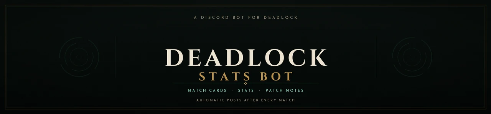
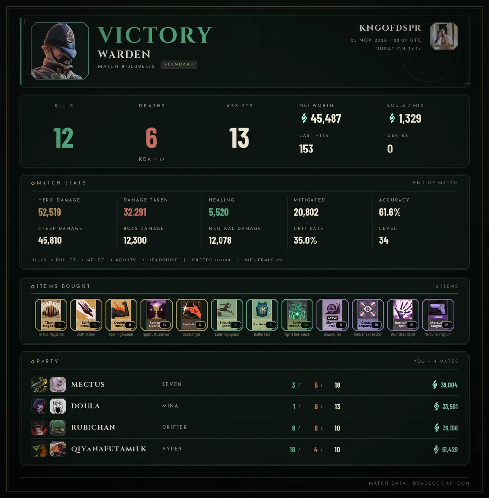
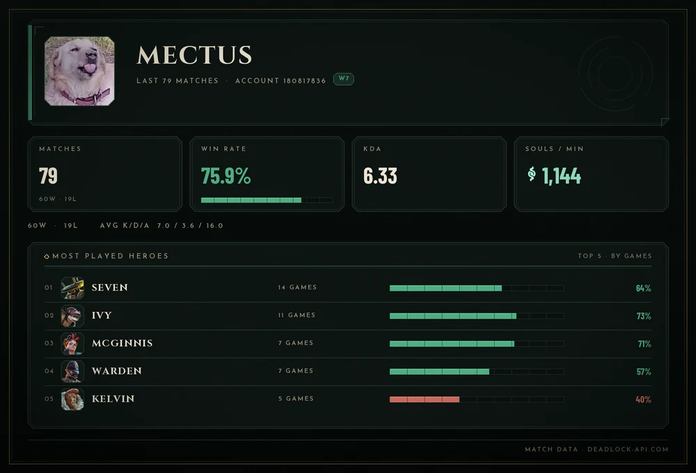
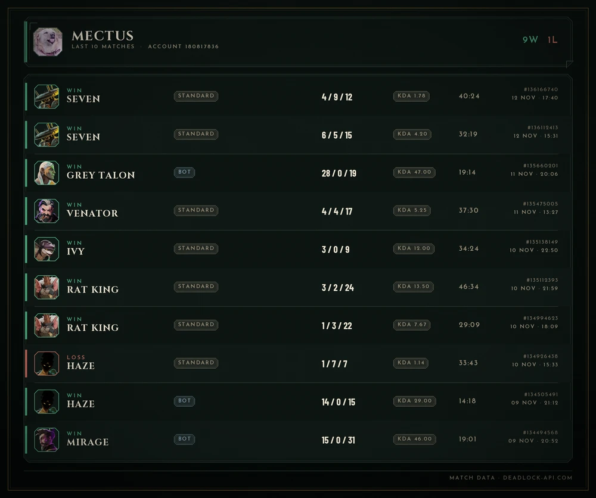
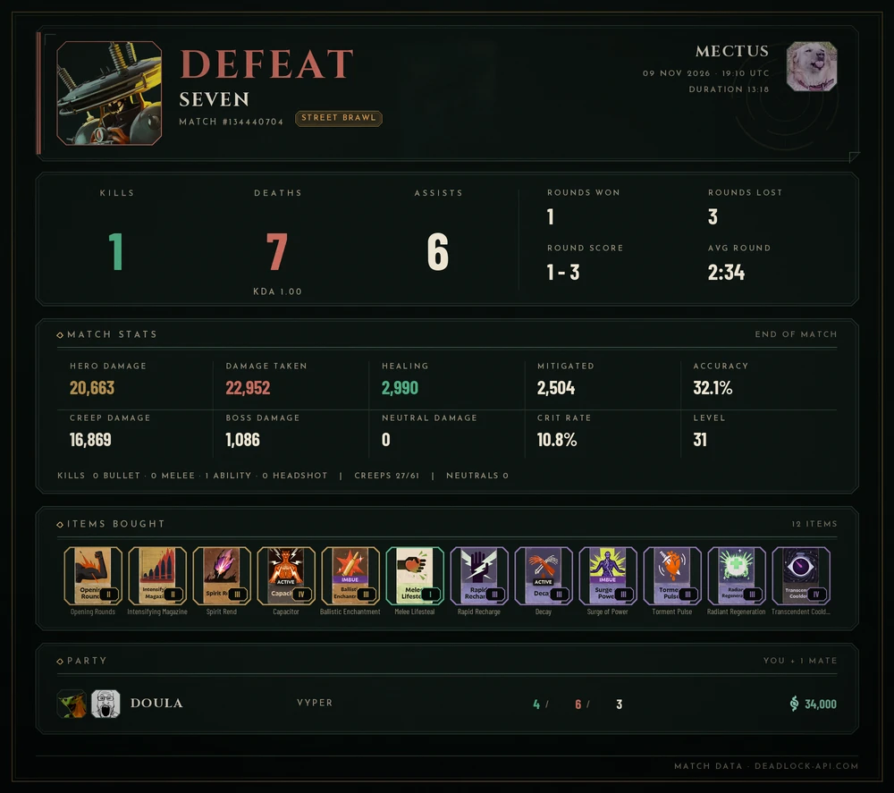

  

  <strong>Art-deco match cards for Deadlock — posted to Discord automatically.</strong> 
  Every item, every stat, every party member. Plus overall stats, recent-match lists and patch notes.

  <a href="https://mectus11.github.io/deadlockstatsbot/">mectus11.github.io/deadlockstatsbot</a>

  
  
  
  
  

## A card after every match

<em>Auto-posted match card: result, hero, K/D/A, net worth, farm, combat stats, the full item build and a compact panel for the party you queued with. Tap <strong>Scoreboard</strong> for the full 12-player table, or <strong>Build Order</strong> for every purchase with its item description.</em>

- **The headline** — win or loss, hero portrait, match type (Ranked, Standard, Bot, Street Brawl), duration and your Steam avatar.
- **The numbers** — K/D/A, net worth, last hits, denies, and a 5×2 grid of combat stats: hero damage, damage taken, healing, mitigation, accuracy, creep/boss/neutral damage, crit rate and level.
- **The build** — every shop item in purchase order, with its real icon, a slot-coloured outline (orange weapon, green vitality, purple spirit) and a tier badge. Up to 24 items; ability upgrades are left out.
- **The party** — a compact panel for each same-party mate: hero and Steam avatars, Steam name, hero, K/D/A and net worth. Hidden entirely when you queue solo.
- **The scoreboard** — a persistent **Scoreboard** button opens a separate, on-demand 12-player scoreboard card (re-fetched when you press it) with both teams, ranks, MVP/party markers and match stats when available.
- **The build order** — a **Build Order** button opens a card listing every shop purchase in the order you bought it, with the match clock, the item's description, and sold or merged components dimmed. Stat-only items have no description text in the API and show their name alone.
- **Rank, when configured** — PP score, rank badge and lobby average ranks come from Statlocker; without a key the card simply leaves them out.

## The rest of the kit

<table>
<tr>
<td width="50%" valign="top">
  
  
<em><code>/stats</code> — record, win rate, KDA, souls/min and your five most-played heroes.</em>

</td>
<td width="50%" valign="top">
  
  
<em><code>/matches</code> — your last ten games at a glance.</em>

</td>
</tr>
</table>

Match cards also cover the less ordinary games — Street Brawl shows the round score and average round length, and bot matches are labelled as such:

  

## Commands

| Command | What it does |
|---|---|
| `/link <steamid> [name]` | Saves your account and turns on automatic posting of new matches. |
| `/save <steamid> [name]` | Saves your account without automatic posting; `/stats` and `/latestmatch` use it right away. |
| `/stats [steamid]` | Overall card: matches, win rate, KDA, souls/min, top heroes with portraits, rank. |
| `/latestmatch [steamid]` | Full match card for the latest game, including items, a compact party panel, and Scoreboard and Build Order buttons. |
| `/matches [steamid] [count]` | Compact list of recent matches: result, hero, mode, KDA (default 10). |
| `/matchstatus [match_id]` | Checks whether the Deadlock API has ingested a match: scoreboard, metadata, salts, or still queued. Defaults to your latest match. |
| `/top` | Server ladder of the best-ranked linked players by PP. |
| `/patchnotes [count]` | Posts the latest Deadlock patch notes from Steam (default 1, max 3) with a Steam link and a Hero Changes button. |
| `/pause` / `/resume` | Stops or restarts automatic match posts without unlinking. `/resume` skips the backlog. |
| `/setchannel [channel]` | (Admins) Channel for automatic match cards; patch notes follow it unless routed elsewhere. Defaults to the current one. |
| `/settings show` | (Admins) Shows the match-card and patch-note channels. |
| `/settings channel feature:<matches\|patches> [channel]` | (Admins) Routes one feature; leave the channel empty to fall back to the match channel. |
| `/status` | Bot uptime, latency, build, linked/paused counts, last polls, Deadlock and Statlocker health. |
| `/invite` | Link to add the bot to another server. |
| `/help` | Command summary. |
| `/unlink` | Forgets your saved account and stops automatic posts for you. |

Right-click a user → **Deadlock stats** for their saved account, or right-click a message containing a Steam ID →
**Deadlock lookup**. Both reply privately. Match cards with roster data include a **Scoreboard** button that opens the full 12-player scoreboard on demand, plus a **Build Order** button for the purchase log and item descriptions.

`steamid` can be a SteamID64 (17 digits), a 32-bit account ID, or a `steamcommunity.com/profiles/...` link
(custom `/id/name` links can't be resolved). Leave it empty to use your saved account. `name` is optional; if you
leave it out, the bot uses your Steam persona. It is only shown on the card when Statlocker isn't set up (it doesn't
change your in-game profile).

## Automatic posting

An admin runs `/setchannel` once, then everyone who wants automatic cards uses `/link` instead of `/save`.

The bot checks every `POLL_SECONDS` (default 120). `/link` records your latest match as a baseline, so only newer
matches are posted; at most 3 per cycle. Item data can lag a match by a few minutes, so a new match waits up to 5
cycles for it before being posted without items. `/pause` stops your posts; `/resume` moves the baseline to the newest
match first, so a long pause does not flood the channel.

Match cards also show a compact **YOUR PARTY** panel with the mates you queued with. The full 12-player scoreboard is available via the card's **Scoreboard** button, which opens a separate scoreboard card in-channel (re-fetched on demand). The **Build Order** button opens a second card: every shop purchase in time order with its item description, dimmed and tagged **SOLD** when it was later sold or merged into an upgrade. Descriptions come from the Deadlock item catalogue; stat-only items have none, so those rows show just the name. The API has no exact party field, so party detection uses its `same_party` heuristic (same team plus Steam friends at match start). It can miss a non-friend party member or include a friend who happened to be on your team. The panel is hidden when no mates are detected, so solo cards look unchanged.

## Patch notes

The bot watches Steam's Deadlock news feed every `PATCH_POLL_SECONDS` (default 600, minimum 300) and posts new notes in
the match channel — or a separate patch channel set with `/settings channel feature:patches` — as a normal message (not an embed), with a **Steam Patch Notes** link button and a
**Hero Changes** button when the patch touches heroes. That button opens a private, paginated hero picker showing only
the lines for the hero you choose.

> **Minor Update - 11-04-2026** 
> 7 heroes changed
>
> > - Healbane: Stacks now diminish 20% more aggressively (at 2 stacks 57.8%->54.7%, at 4 stacks 82.2% to 72%)
> > - Apollo: Riposte - Pommel Hit now also disarms the enemy
> > - Baba: Spirit Resistance scaling reduced from 0.7 to 0.5
> > - …and 28 more changes

`/patchnotes [count]` posts the newest notes on demand. `/setchannel` posts the current patch as confirmation when it
is first run (or when the channel changes). A channel that was already configured before this feature gets the newest
note once on the first poll, then only future patches — nothing older is backfilled.

## Setup (Windows)

1. Create a bot at <https://discord.com/developers/applications>, copy its token, invite it with the `bot` and
   `applications.commands` scopes and *Send Messages* + *Attach Files*.
2. Put the token in `.env` (`DISCORD_TOKEN=...`; see `.env.example`).
3. Double-click `run.bat`. It installs everything and starts the bot. Keep the window open.
4. In Discord: `/save <your steamid>` to get your own stats right away. For automatic posts after every match, an
   admin also runs `/setchannel`, and you use `/link` instead of `/save`.

Elsewhere: `pip install -r requirements.txt`, then `python bot.py` (Python 3.10+).

## Where the data comes from

- **Matches, items, hero/item names and pictures:** [deadlock-api.com](https://deadlock-api.com), no key needed.
  Pictures are downloaded once and cached in `./cache`.
- **Rank, PP score, lobby average rank:** the [Statlocker API](https://statlocker.gg/api). It needs a key you apply for
  on that page. Without `STATLOCKER_API_KEY` the cards simply leave those parts out. Cards that use Statlocker data
  carry the required "Powered by Statlocker" line.

## Customising

The souls icon is `assets/souls.png`; replace that file to change it (PNG, transparent background works best); it is
picked up automatically after a restart.

To download every item icon in one go, double-click `download_icons.bat` (needs internet; it saves them into
`assets/items`, skipping files you already have). Your own item icons can also go in `assets/items` (for example
`Basic Magazine.png`). They are matched to items by name, ignoring case, spaces and words like "icon", and are used
instead of the downloaded ones.

A custom font: put `bold.ttf` and `regular.ttf` in `assets/fonts/`.

## If something is empty or wrong

Several response shapes were matched against documentation, not a live response. Run `probe.bat` (it asks for your
Steam ID and writes `probe_output.txt`): it prints the real fields, what the parsers made of them, and whether each
image URL actually downloads. Typical results:

- Cards show `-` for kills/souls, or the result is wrong: the match-history/metadata field names differ; send the output.
- No item or hero pictures (labelled grey tiles instead): the image field names or host differ; send the output.
- Hero names show as `Hero #12`: the hero list couldn't be loaded (check the console for a warning).

## Built with AI

This project was made with AI: the code, card renderer and documentation were built in a combination of
[**Claude**](https://claude.ai) (Anthropic) and [**OpenCode**](https://opencode.ai), with the bot's owner directing the
work and testing every change on a live Discord server.

## Development

`python -m unittest test_core test_deploy test_patchnotes -v` runs the parsing/stats/database tests, the deploy script's
tests and the Steam patch-note tests. `python preview_cards.py` renders sample cards with generated stand-in icons into
`./preview/` for fast theme iteration; the screenshots above were rendered from real matches.

Files: `bot.py` commands + pollers · `cards.py` image cards · `deadlock_api.py` / `statlocker.py` API clients ·
`models.py` parsing · `steam_news.py` Steam patch-note parsing · `patchnote_views.py` patch-note buttons ·
`images.py` download cache · `stats.py` aggregates · `steam.py` ID parsing · `db.py` storage · `probe.py` live-data
check.

## Deploying

The bot runs as a Docker container on an OVH game panel. Pushing to `main` publishes a new image via GitHub Actions;
applying it on the VPS is `sudo bot-update` (from `deploy/bot-update.py`), which pulls, recreates the container safely
and re-points the panel at it, rolling back if the new build doesn't come up. Full details, including the one-time
install, are in [DEPLOY.md](DEPLOY.md#updating-the-ovh-panel-deployment).
